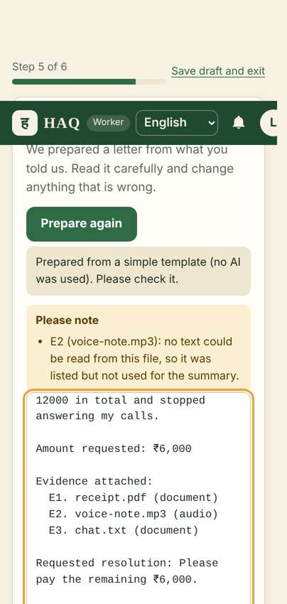

# HAQ — your wages, your right

HAQ (हक़ · ಹಕ್ಕು — "what is rightfully yours") helps informal workers in India explain an unpaid-wage or workplace problem in their own language, keep their proof safe, send a clear complaint to their employer, and follow it through to a settlement and confirmed payment.

Employers get a clear, organised claim they can answer, with only the evidence the worker chose to share.

> HAQ is not a court and gives no legal advice. Wage results are arithmetic estimates, not legal findings.



## Quick start (Windows)

You need **Python 3.10+** and **Node.js 18+**.

```bat
cd %USERPROFILE%\Documents\HAQ
setup.bat        :: one time: Python environment, packages, builds the web app
start.bat        :: starts HAQ and opens http://localhost:8000
```

Optional: `demo.bat` creates labelled DEMO accounts (see docs/DEMO_SCRIPT.md). Run all checks with `test.bat`.

macOS/Linux: `./setup.sh`, then `cd backend && .venv/bin/python -m uvicorn app.main:app --port 8000`.

In development no mail server is needed: the 6-digit verification code is shown in a yellow **DEV** box on the "Confirm your email" card.

## What it does

**Workers**
- Guided 6 steps: describe (type or speak) → add proof → key details → check summary → letter → choose what to share and send.
- Any mix of photos, screenshots, PDFs, Word files, text, voice notes and videos. Each file is validated, fingerprinted (SHA-256), stored privately and read in the background where possible.
- Automatic checks that point out things to review — never fraud accusations.
- **13 Indian languages** for screens, voice typing and letter headings (English, Hindi, Bengali, Telugu, Marathi, Tamil, Urdu, Gujarati, Kannada, Malayalam, Odia, Punjabi and Assamese). Workers can also choose **"Another language"** and speak or type in any language at all — their words are kept exactly as given.
- A complaint letter in the worker's language; every fact editable; nothing sent without explicit confirmation.
- Track replies, accept or reject offers, confirm or dispute payments, print a full record.
- Wage calculator (daily, hourly, weekly, monthly, piece, task) and optional work records.

**Employers**
- See only claims sent to their verified email, and only the files shared with them.
- Acknowledge, reply, ask questions, attach files, offer a settlement, record a payment with a receipt.
- Cannot change the worker's claim or evidence; recording a payment never closes a claim by itself.

## IBM technology

| Technology | Status in this project |
|---|---|
| **IBM Granite on IBM watsonx.ai** | Implemented (`backend/app/ai/providers.py`, `WatsonxProvider`), switchable with `AI_PROVIDER=watsonx`. Unit-tested with mocked HTTP. **Not yet run live** — needs your IBM Cloud API key and project ID. |
| **IBM Granite via Ollama** (local) | Implemented (`OllamaProvider`), `AI_PROVIDER=ollama`. Unit-tested with mocked HTTP. **Not yet run live.** |
| **IBM Cloud Code Engine** | Dockerfile + steps prepared. **Not deployed.** |
| **IBM Bob** | AI development partner in the IDE. What Bob did on this project is recorded in `IBM_BOB_USAGE.md` (tasks: `docs/BOB_GUIDE.md`). |

Without an AI provider HAQ still works fully, using a deterministic template, and tells the user that no AI was used.

## Architecture (short)

React + Vite frontend → FastAPI backend (one process, also serves the built frontend) → SQLite + private file folder; optional IBM Granite for the letter narrative. See **docs/ARCHITECTURE.md** for diagrams, data model and the claim state machine.

## Project files

```
HAQ/
├── README.md            start here
├── IBM_BOB_USAGE.md     how IBM Bob was used on this project
├── setup.bat            one-time setup (Windows)
├── start.bat            start the app → http://localhost:8000
├── demo.bat             create labelled DEMO accounts
├── test.bat             run all checks
├── backend/             server: Python FastAPI, database, tests
├── frontend/            app screens: React, 13 languages
├── e2e/                 automatic browser test + sample files
└── docs/
    ├── HAQ_Presentation.pptx
    ├── ARCHITECTURE.md        how it is built
    ├── PROJECT_REQUIREMENTS.md
    ├── API_DOCUMENTATION.md
    ├── DEMO_SCRIPT.md         7-minute demo
    ├── DEPLOYMENT_GUIDE.md    running, IBM Granite set-up, going online
    ├── TESTING_REPORT.md
    ├── SECURITY_NOTES.md
    ├── KNOWN_LIMITATIONS.md
    ├── BOB_GUIDE.md           step-by-step tasks to do in IBM Bob
    └── screenshots/
```

## Important commands

| Task | Command |
|---|---|
| Set up | `setup.bat` |
| Start | `start.bat` → http://localhost:8000 |
| Demo data | `demo.bat` |
| All checks | `test.bat` |
| Backend tests only | `cd backend && .venv\Scripts\python -m pytest -q` |
| Frontend tests only | `cd frontend && npm test` |
| Frontend dev server | `cd frontend && npm run dev` → http://localhost:5173 |
| API docs (dev) | http://localhost:8000/api/docs |
| Health | http://localhost:8000/api/health |
| Browser journey | `pip install playwright && python -m playwright install chromium && python e2e\journey.py` |

## Environment variables

Copy `backend/.env.example` to `backend/.env` (setup does this). No real secrets are in the repository.

| Variable | Default | Purpose |
|---|---|---|
| `APP_ENV` | `development` | `development`, `production` or `test` |
| `SECRET_KEY` | auto in dev | **Required in production**, ≥ 32 chars |
| `HAQ_DATA_DIR` | `backend/data` | Database + private files |
| `TOKEN_TTL_MINUTES` | `720` | Session length |
| `MAX_UPLOAD_MB` / `MAX_MEDIA_UPLOAD_MB` | `20` / `50` | Upload limits |
| `CORS_ORIGINS` | localhost:5173 | Only if the UI is on another origin |
| `EMAIL_MODE` | `console` | `console` or `smtp` |
| `SMTP_HOST`, `SMTP_PORT`, `SMTP_USER`, `SMTP_PASSWORD`, `SMTP_FROM` | — | SMTP settings |
| `AI_PROVIDER` | `local` | `local`, `watsonx` or `ollama` |
| `AI_TIMEOUT_SECONDS` | `60` | AI request timeout |
| `WATSONX_URL`, `WATSONX_APIKEY`, `WATSONX_PROJECT_ID`, `WATSONX_MODEL_ID` | — | IBM watsonx.ai |
| `OLLAMA_URL`, `OLLAMA_MODEL` | `http://127.0.0.1:11434`, `granite3.3:2b` | Local Granite |
| `OCR_LANGUAGES` | `eng` | Tesseract languages, e.g. `eng+hin+kan` |
| `VITE_API_BASE_URL` (frontend) | empty | Only if the API is on another origin |

## Troubleshooting

See docs/DEPLOYMENT_GUIDE.md §6. Most common: no verification email (use the DEV box), the employer must register with the exact email the worker typed, and voice typing needs Chrome or Edge.
