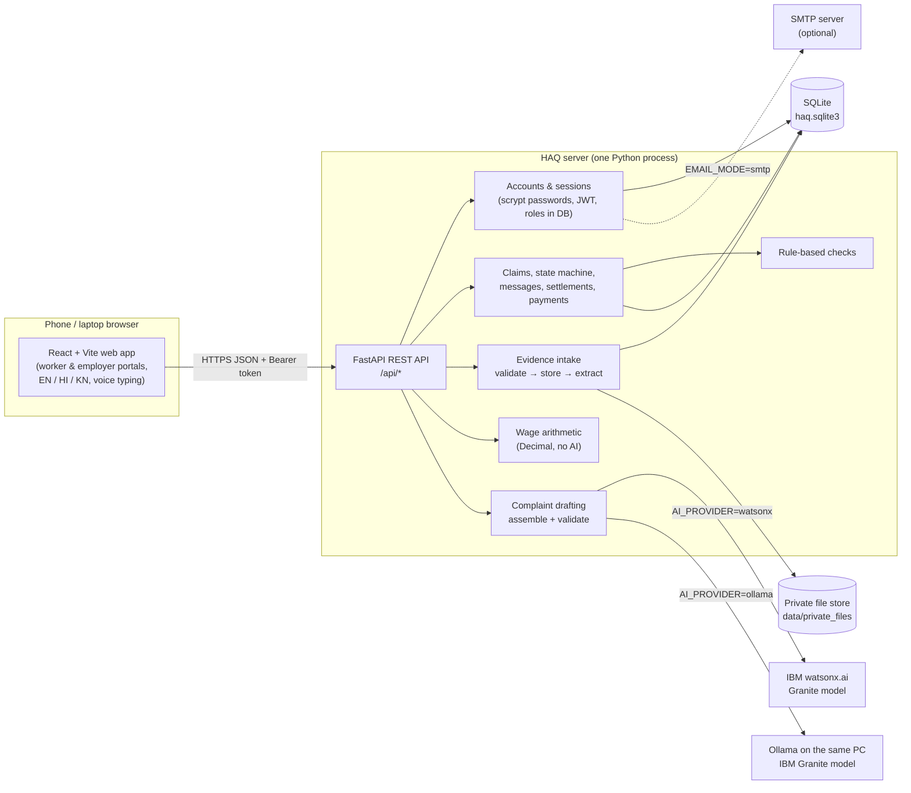
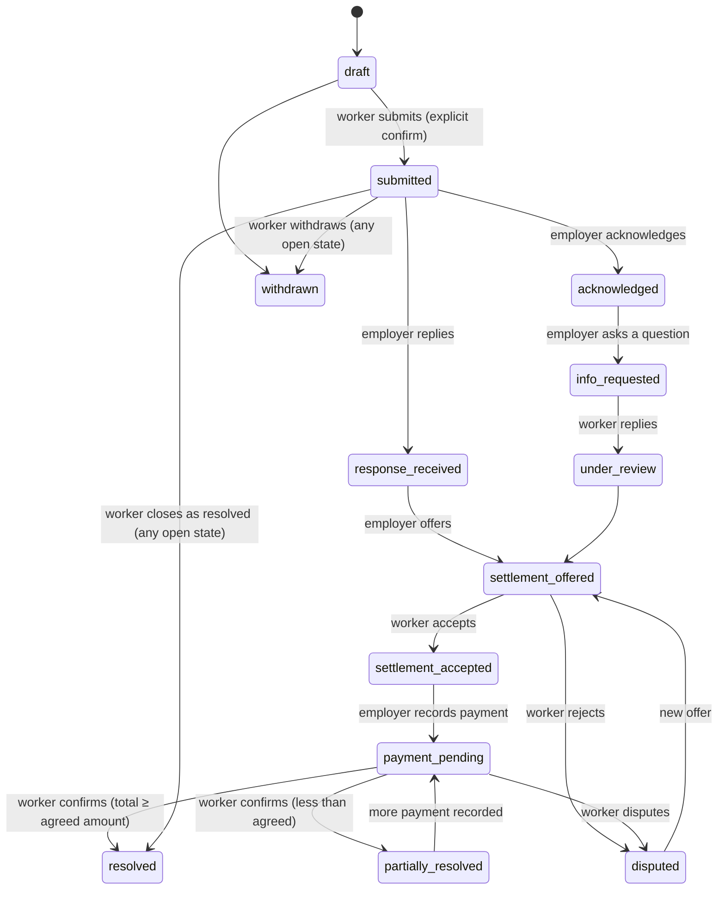

# HAQ — Architecture

## Overview



In production the backend also serves the built React files, so the whole app is one process on one port. In development, Vite (port 5173) proxies `/api` to the backend (port 8000).

## Technology stack

| Layer | Choice | Why |
|---|---|---|
| Frontend | React 18, React Router 7, Vite 6 | Fast, simple, runs on cheap phones; no heavy UI kit. |
| Backend | Python 3.10+, FastAPI, Pydantic | Typed validation at the edge, automatic OpenAPI docs. |
| Database | SQLite (WAL mode) with numbered SQL migrations | Zero setup on a laptop; schema is portable to PostgreSQL / Db2. |
| Files | Local private folder, random file names | Never web-served; downloads only through an authorised endpoint. |
| Auth | One identity system, scrypt hashes, HS256 JWT with a per-user `token_version` | Role is stored server-side; tokens can be revoked. |
| AI | Provider interface: local template / IBM watsonx.ai Granite / Ollama Granite | AI is optional and swappable; output is validated. |
| Extraction | pypdf, DOCX XML parsing, Tesseract OCR (if installed) | Small, offline-capable. |
| Tests | pytest, Vitest + Testing Library, Playwright end-to-end | Backend, frontend and real-browser coverage. |

## Source layout

```
HAQ/
├── backend/
│   ├── app/
│   │   ├── main.py              app factory, middleware, static frontend
│   │   ├── config.py            settings from environment / .env
│   │   ├── db.py                SQLite connection + migration runner
│   │   ├── security.py          passwords, JWT, one-time codes, rate limiting
│   │   ├── errors.py            consistent JSON errors
│   │   ├── deps.py              auth dependencies, history/notification/audit helpers
│   │   ├── mailer.py            console or SMTP email (no claim details in mail)
│   │   ├── routes_auth.py       register/login/verify/reset/logout-all
│   │   ├── routes_worker.py     claims, evidence, drafting, submission, work records, wages
│   │   ├── routes_employer.py   inbox, responses, attachments, offers, payments
│   │   ├── routes_common.py     health, notifications, downloads, export, dev outbox
│   │   ├── claims_service.py    authorised loading + role-specific views
│   │   ├── claim_state.py       state machine
│   │   ├── evidence_files.py    validation, storage, text/amount/date extraction
│   │   ├── checks.py            rule-based consistency findings
│   │   ├── wages.py             Decimal wage arithmetic
│   │   └── ai/                  providers.py (watsonx, Ollama, local) + drafting.py
│   ├── migrations/001_initial.sql
│   ├── scripts/seed_demo.py
│   └── tests/                   60 pytest tests
├── frontend/src/                React app (pages/, components/, i18n.js, api.js)
├── e2e/journey.py               Playwright browser journey + screenshots
└── docs/screenshots/            screenshots from the e2e run
```

## Data model

All money is stored as decimal text (e.g. `"6400.00"`) and calculated with Python `Decimal`.

| Table | Purpose | Key rules |
|---|---|---|
| `users` | Identity + profile for both roles | `role` CHECK in (worker, employer); `email` unique; `employer_verification` separate from email verification; `token_version` for revocation |
| `auth_codes` | Email-verification and password-reset codes | Stored as HMAC hashes; 30-min expiry; 5 attempts |
| `email_outbox` | Record of every email and whether it was really sent | Body kept only in console (dev) mode |
| `engagements` | Optional work records | Owned by one worker |
| `claims` | The claim | Owner `worker_id`; recipient `employer_email`; `submit_key` unique (idempotency); cannot be deleted (trigger) |
| `evidence` | Every uploaded file (worker or employer) | SHA-256, size, uploader, claim; `shared_with_employer`; extraction status; cannot be deleted; original metadata immutable (triggers) |
| `complaint_versions` | Every AI/template/worker version of the letter | Provider and model recorded |
| `messages` | Replies and questions | Author role recorded |
| `settlements` | Offers | Status offered/accepted/rejected/superseded; optional expiry |
| `payments` | Payments recorded by employer | `worker_confirmation` pending/confirmed/disputed |
| `claim_events` | Timeline / history | Append-only (delete blocked) |
| `notifications` | In-app updates | `dedupe_key` unique, so retries never duplicate |
| `audit_log` | Security events (sign-ins, failures, resets) | No passwords or tokens stored |

## Claim state machine (`backend/app/claim_state.py`)



Each action is allowed only for one role and from a fixed set of states; anything else returns HTTP 409. Clients never send a status.

## Authorisation model

- **Worker** sees only claims where `claims.worker_id = me`. Wrong IDs return 404 (same as non-existent), so IDs cannot be probed.
- **Employer** sees only claims where `employer_email = my verified email` **and** the claim has been submitted. Employers must verify their email first — this proves they own the address the claim was sent to.
- Employers see the complaint, the worker's name/phone, files the worker ticked, and their own files. They never see the worker's original description, private notes, unshared files, extracted text, checks, or pre-submission history.
- File downloads re-check all of the above on every request.

## AI drafting pipeline (`backend/app/ai/`)

1. `build_facts` collects the worker's description, the fields they entered, the deterministic wage calculation, and extracted evidence text (labelled E1, E2…).
2. If an AI provider is configured, the model is asked for **only** the "What happened" paragraph as JSON. Evidence is wrapped in `<file>` tags and the system prompt says it is data, not instructions.
3. `validate_ai_output` rejects the reply if it is not JSON, mentions any amount or date that does not appear in the worker's own information, or cites an evidence label that does not exist.
4. On any provider error or rejection, the deterministic template narrative is used and the worker sees a warning saying so.
5. `assemble` builds the full letter deterministically (reference, parties, period, amount + calculation, evidence index, requested outcome, disclaimer) in the worker's language.
6. The worker edits the letter freely; every version is stored. Nothing is sent without an explicit confirmation.

## Evidence pipeline (`backend/app/evidence_files.py`)

1. Body size checked from `Content-Length` before parsing; file streamed to disk in 256 KB chunks with a running size limit and SHA-256.
2. Extension allow-list + file-signature (magic bytes) check; mismatches rejected.
3. Stored under a random 32-hex-character name in the private folder; the original name is kept for display only.
4. A background task extracts text (TXT, PDF text layer, DOCX, image OCR when Tesseract exists). Audio/video are stored but marked "not transcribed". Failures are recorded and shown.
5. Amounts and dates are pulled from the text as suggestions; the worker can correct the text.
